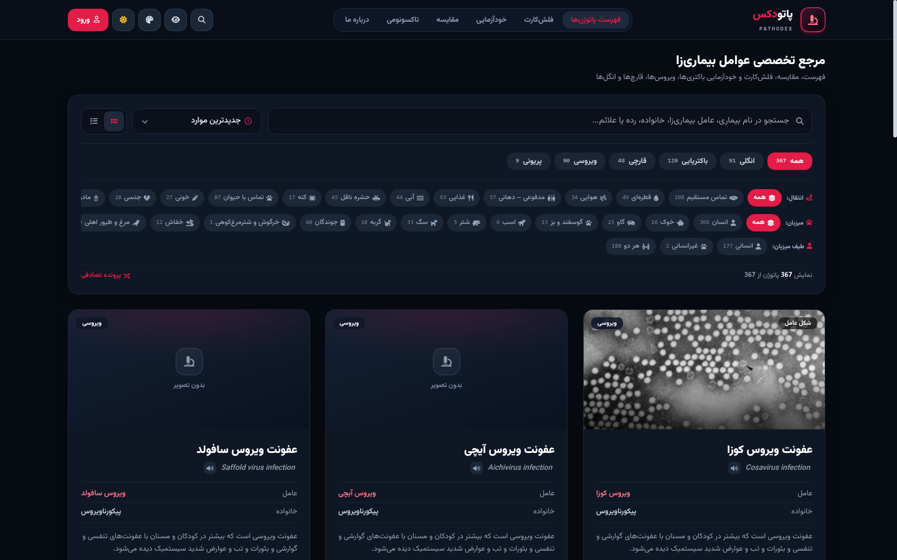
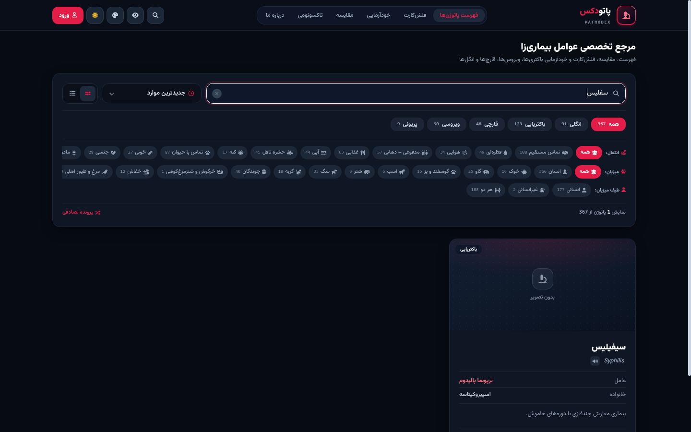
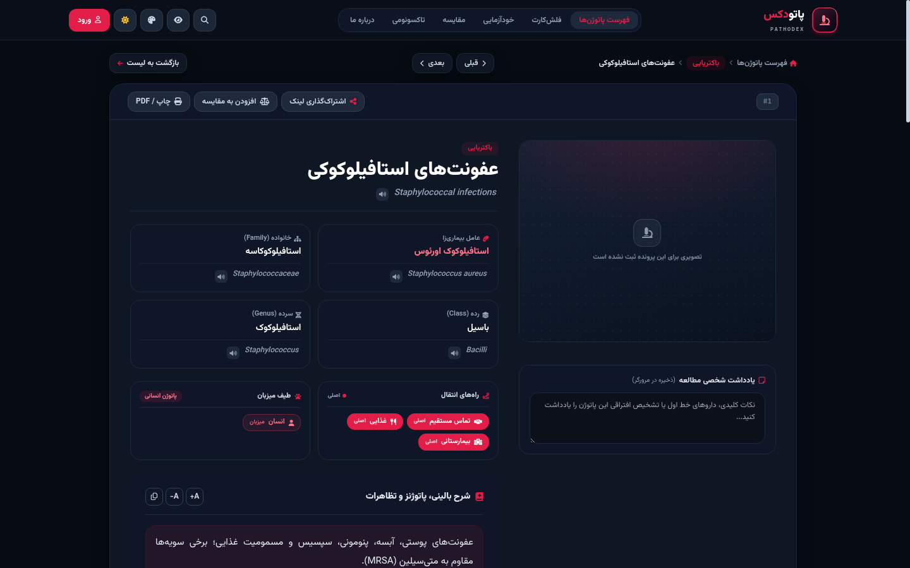
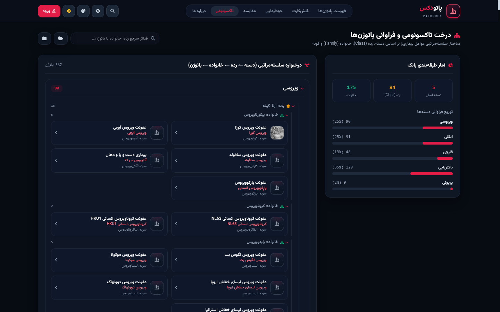
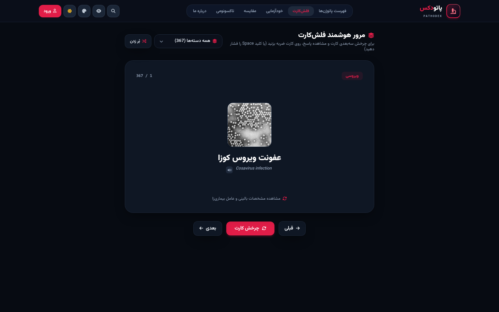
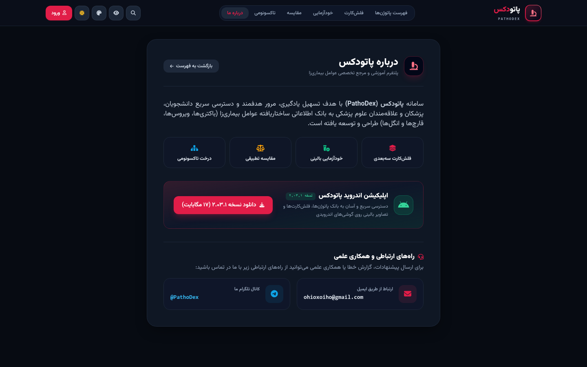

# پاتودکس — اپلیکیشن اندروید

> **PathoDex — Android app**
> An Android client for [pathodex.ir](https://pathodex.ir), a Persian reference for
> pathogens with clinical dossiers, flashcards and self-assessment.

با این برنامه پرونده‌ی بالینی عوامل بیماری‌زا را روی گوشی می‌خوانید، فلش‌کارت
می‌زنید و خودآزمایی می‌کنید. محتوایش همان محتوای سایت است؛ بار اول با اینترنت
دریافت می‌شود و بعدش روی دستگاه می‌ماند، آن‌وقت حتی بدون اینترنت هم کار می‌کند.

این مخزن فقط کد اپلیکیشن را دارد. پرونده‌های پزشکی از سرور پاتودکس گرفته
می‌شوند و در مخزن نیستند. مجوز آن محتوا هم جدا از مجوز کد است؛ [NOTICE](NOTICE)
را ببینید.

## تصاویر

| فهرست پاتوژن‌ها | جستجوی خطاپذیر |
|---|---|
|  |  |

| پرونده‌ی بالینی | درخت تاکسونومی |
|---|---|
|  |  |

| فلش‌کارت | درباره‌ی سامانه |
|---|---|
|  |  |

تصویر دوم جستجوی «سفلیس» است که همان لحظه‌ی تایپ به پرونده‌ی سیفیلیس می‌رسد،
نه تنها وقتی کلمه کامل شود.

## نصب

نسخه‌ی أحدث را از [صفحه‌ی نسخه‌ها](https://github.com/OHIOXOIHO/PathoDex-APP/releases)
بردارید و نصب کنید. اندروید هنگام نصب مستقیم یک هشدار می‌دهد؛ این هشدار
Play Protect است، نه مشکل امنیتی. پیام «برنامه مسدود شد» هم همین است.

برای ورود با گوگل در نسخه‌ی رلیز، اثرانگشت گواهی امضای آن نسخه باید در
Google Cloud به‌عنوان OAuth Client از نوع Android ثبت شده باشد.

## ساخت

به JDK 21، Android SDK (compileSdk 36) و Gradle 9 نیاز دارید.

```bash
export JAVA_HOME=/path/to/jdk-21
export ANDROID_HOME=/path/to/android-sdk
export PATH="$JAVA_HOME/bin:$ANDROID_HOME/platform-tools:$PATH"

gradle assembleDebug          # app/build/outputs/apk/debug/
gradle testDebugUnitTest      # ۵۱ آزمون واحد
```

نسخه‌ی دیباگ با `debug.keystore` امضا می‌شود. برای رلیز، کلید را از طریق
متغیرهای `KEYSTORE_PATH`، `STORE_PASSWORD` و `KEY_PASSWORD` به گرادل می‌دهیم؛
گذرواژه در مخزن ثبت نمی‌شود و کلید هم باید بیرون از مخزن نگه داشته شود.

## برای کسی که می‌خواهد فورک کند

فورک کردن معمولی است. بعد از فورک، دو جا را عوض کنید تا برنامه به سرور خودتان
برود:

- `app/src/main/java/com/example/data/api/ApiClient.kt` مقدار `BASE_URL`
- `app/src/main/java/com/example/data/model/Disease.kt` مقدار `HOST`

اگر نمی‌خواهید به سرور دیگری وصل شود، کافی است یک API ساده ارائه دهید که
پاسخ `/api/diseases` را بدهد. ساختار پاسخ در `Disease.kt` توصیف شده.

## چیزهایی که شاید برایتان جالب باشد

**جستجوی خطاپذیر** (`data/model/SearchMatcher.kt`). کاربر معمولاً حروف عربی
را به‌جای فارسی می‌نویسد، نیم‌فاصله را فراموش می‌کند، یا اسم لاتین را اشتباه
می‌نویسد. این لایه حروف ي/ی و ك/ک را یکدست می‌کند و نیم‌فاصله‌ی جاافتاده را
دربیاورد، بعد با فاصله‌ی ویرایش، شباهت جارو-وینکلر و زیروالی‌بودن تطبیق
می‌دهد. «سفلیس» و «سیفلیس» هر دو به سیفیلیس می‌رسند. همین منطق در نسخه‌ی وب
پیاده‌شده تا دو محصول رفتار یکسانی داشته باشند. آزمون‌های واحد هم همین‌جا هستند.

**طراحی متمرکز.** رنگ‌ها، فاصله‌ها و اندازه‌های فونت همه در لایه‌ی تم
(`ui/theme`) تعریف شده‌اند. در صفحه‌ها رنگ یا فاصله‌ی ثابت نگذارید.

**راست‌به‌چپ.** چیدمان به‌صورت اجباری RTL است چون محتوا فارسی است. اسم‌های
لاتین هم در یک container مجزای LTR نمایش داده می‌شوند.

## همکاری

قبل از کار جدی، یک ایشو باز کنید تا سر راه هم برویم. برای تغییر محتوای
پزشکی به سایت پاتودکس مراجعه کنید، چون این مخزن محتوا ندارد.
[CONTRIBUTING](CONTRIBUTING.md) را ببینید.

## مجوز

کد این مخزن تحت [مجوز MIT](LICENSE) است.

محتوای پزشکی که برنامه نشان می‌دهد حق تألیف جداگانه‌ای است و شامل مجوز MIT
نمی‌شود. جزئیات و سلب مسئولیت پزشکی در [NOTICE](NOTICE) نوشته شده.

## سلب مسئولیت

پاتودکس ابزار آموزشی برای دانشجویان و پزشکان است، نه دستگاه پزشکی. برای
تصمیم‌گیری بالینی به راهنماهای جاری و منابع اولیه مراجعه کنید.
